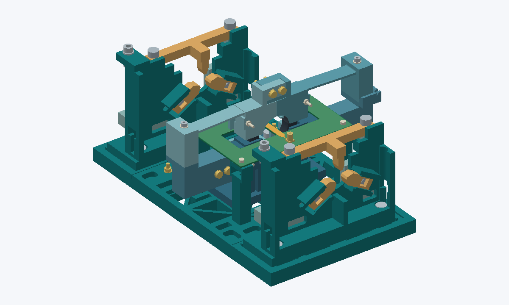

# RF 전류 프로브와 Ethernet VNA 지그

산업용 Ethernet·24 V 하네스에서 간헐 오류가 날 때 케이블의 고주파 전류도 함께 변하는지 관측하는 프로젝트입니다. 분할 페라이트 코어로 연결된 케이블을 감싸고, 권선의 SMA 출력 전압을 50 Ω 계측기로 읽습니다. 평판 교정 지그는 코어를 지나는 기준 전류를 만들어 주파수별 전압-전류 환산에 씁니다.

Ethernet VNA 지그는 별도 보드입니다. B-RJ2 공통 발룬 보드는 RJ45 쌍을 SMA 50 Ω 포트에 연결하고, LLC·TE·Molex 어댑터는 각 커넥터에 맞게 배선을 이어 줍니다.



*A19 조립 FreeCAD 원본을 렌더링했습니다. 가운데에 프로브 헤드와 평판 교정 PCB가 있고, 양쪽에 케이블 클램프가 있습니다.*

## 2026-11-20 기준 진행 상황

| 작업 | 확인한 범위 | 다음 확인 |
| --- | --- | --- |
| 설계·입고 | Head A04 SMA R2, Fixture A03 SMA R2, B-RJ2 PCB 4종과 A19/A18/C10 출력 15종 20개를 10월 21일 입고 기준과 대조했습니다. | [제작 원본·설치 수량·해시](docs/CURRENT_BUILD.md) |
| 실물 조립 | 10월 26일 클램프 유격으로 사용을 보류했습니다. 10월 27일 이관 기록상 권선 접속은 약 3 MΩ 보고 이후 확인이 남아 있습니다. | [실물 확인 순서와 기록](docs/CURRENT_READINESS.md#실물-조립과-도통) |
| 프로브 교정지그 | A03의 수직·직각 SMA 모델을 1–150 MHz에서 비교했습니다. 개체별 교정에 필요한 출력 기준 분석 코드와 합성 시험을 갖췄습니다. | [수치 검증 결과](selected-evidence/sma-simulation/REPORT.md) · [실측·교정 절차](analysis/OUTPUT_REFERENCE.md) |
| Ethernet VNA | B-RJ2의 24개 단자 구동을 완료했고, 보드 한 장에서 비교할 4개 응답을 1–200 MHz에서 저장했습니다. | [사전 예측과 원시 파형](selected-evidence/ethernet-vna-prediction-v1/README.md) · [네 결선과 실측 비교](measurements/ethernet-vna/README.md) |

공개 Git에 등록된 개체별 RF 실측 세션은 **0건**입니다. 프로브의 유효 대역과 불확도는 실제 SMA·권선·기준면을 기록한 개체별 교정으로 정합니다. B-RJ2의 실측 비교는 프로브 조립과 별도로 진행할 수 있습니다.

## 처음 보는 에이전트의 진입 순서

1. [AGENTS.md](AGENTS.md)와 [현재 진행 상태](docs/CURRENT_READINESS.md)에서 프로젝트 범위, 완료 조건, 남은 실물 확인을 읽습니다.
2. [제작 기준](docs/CURRENT_BUILD.md)에서 PCB·3D 출력 원본을 선택합니다. [문서 색인](docs/DOCUMENT_INDEX.md)에는 백서, 설계 결정, 벤치 절차와 날짜별 기록이 있습니다.
3. 새 측정은 개체 ID와 조건을 갖춘 별도 세션으로 추가합니다. [RF 프로브 분석](analysis/README.md) · [Ethernet VNA 비교](measurements/ethernet-vna/README.md)

## Git만으로 확인할 수 있는 것

Linux 또는 Git Bash에서 `sha256sum -c release/design.sha256`을 실행하면 제작 기준의 공개 설계 파일 84개를 대조할 수 있습니다. 오프라인 분석 시험과 B-RJ2 파형 재계산은 Python 3.12.6에서 확인했습니다. 저장소 루트에서 실행합니다.

```sh
python -m pip install -r analysis/requirements.txt
python -B -m pytest tests measurements/ethernet-vna -q -p no:cacheprovider
python -B selected-evidence/ethernet-vna-prediction-v1/verify.py --numerical
```

구조와 결선의 배경은 [RF 프로브 ATLAS](https://ckh7488.github.io/showcase/reports/rf-current-probe/)와 [Ethernet VNA ATLAS](https://ckh7488.github.io/showcase/reports/ethernet-vna-fixture/)에서 볼 수 있습니다. 리비전과 작업 상태는 위 제작 기준과 진행 상태를 사용합니다. 11월 4일 원본 보관 이력은 [최초 목록](SYNC_CHECKPOINT_20261104.json)과 [추가 목록](SYNC_SUPPLEMENT_20261104.json)에 남아 있습니다.
