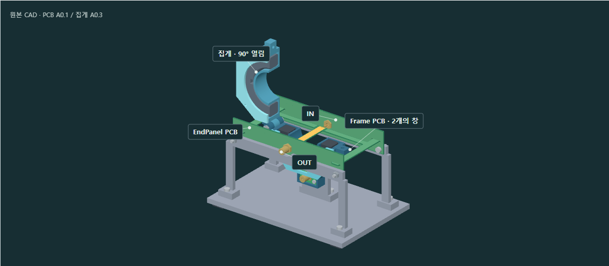

# 집게형 RF 전류 프로브

산업용 Ethernet에서 간헐 오류가 날 때 케이블의 고주파 전류도 함께 변하는지 관측하기 위해 설계한 프로브입니다. 연결된 케이블을 코어로 감싸고, SMA 출력에서 계측기로 전압을 읽습니다. 교정 지그는 주파수별로 그 전압을 전류로 환산할 기준을 구하는 데 씁니다.

*구조를 설명하는 초기 CAD입니다. 위의 집게가 케이블을 감싸고 아래의 PCB 지그는 교정에 사용합니다.*

## 확인한 범위

- **시뮬레이션.** 직각 SMA 교정 지그 모델의 **1–150 MHz 계산**에서 마지막 시간 구간을 빼고 다시 비교해 전달 응답과 전류 환산 계수의 안정성을 확인했습니다. [계산 결과와 조건](selected-evidence/sma-simulation/REPORT.md)
- **실물 조립.** 2026년 10월 26일 조립품에서 클램프 유격이 관찰돼 사용을 보류했습니다. RF 유효 대역과 정확도를 판정하려면 개체별 교정과 실측 원자료가 필요합니다. [조립 관찰과 남은 검증](docs/CURRENT_READINESS.md)

## 설계와 분석 자료

- [공개 ATLAS · 구조, 교정 연결과 조립 안내](https://ckh7488.github.io/showcase/reports/rf-current-probe/)
- [PCB·기구 CAD의 제작 검토 구성](docs/CURRENT_BUILD.md) · [오프라인 분석](analysis/README.md) · [문서 색인](docs/DOCUMENT_INDEX.md)

## Ethernet 발룬 보드 · 예측에서 실측으로

[B-RJ2의 openEMS 모델·설정·완료 원시 파형 한 세트](selected-evidence/ethernet-vna-prediction-v1/README.md)와 [측정 PC 준비·네 결선·비교 실행](measurements/ethernet-vna/README.md)을 함께 보관합니다. 2026-11-17에 계산한 사전 예측은 그대로 두고, 측정 세션별 Touchstone 원본과 비교 결과를 추가합니다.

기본 소스 보관본의 기준일은 2026년 11월 4일입니다. [파일 목록](SYNC_CHECKPOINT_20261104.json)과 [추가 보관 목록](SYNC_SUPPLEMENT_20261104.json)에 당시 파일 경로와 원본 해시를 기록했습니다. Ethernet 사전 예측 보존 묶음은 2026년 11월 20일 추가했습니다.
