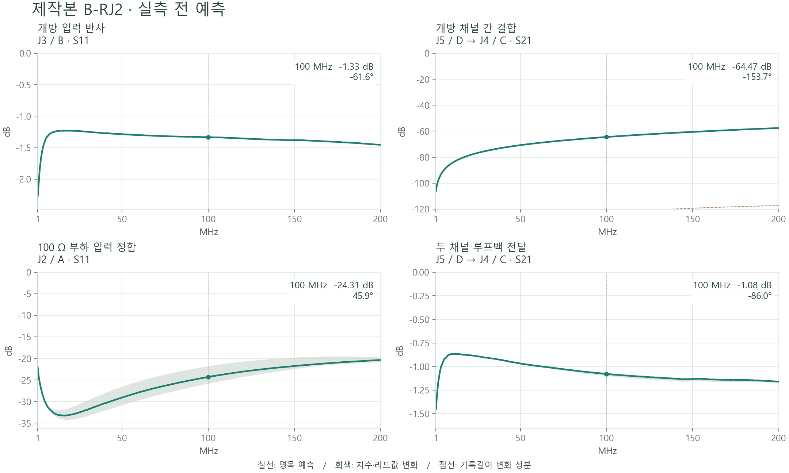

# B-RJ2 · openEMS 사전 예측 v1

최종 제작본의 PCB 형상과 DNP 상태로 24개 단자를 하나씩 구동하고, 발룬·SMA·RJ45·시험 플러그 회로를 연결했습니다. 24/24 구동과 수치 검토는 2026-11-17에 완료했습니다. 새 네 구성의 VNA RF 값은 예측 입력에 사용하지 않았습니다.

[모델·3D·결과를 보는 ATLAS](https://ckh7488.github.io/showcase/reports/ethernet-vna-fixture/) · [측정 PC에서 이어가기](../../measurements/ethernet-vna/README.md)

## 보존한 한 세트

- `input/`: 제작 CAD, EM 입력 형상, 제조사 발룬 데이터, 플러그 치수와 사진.
- `run.py`·`analyze.py`·`network.py`와 JSON: 형상 생성, 파형 추출, 회로 결합 코드와 주요 설정. 고정 입력의 원본 해시는 [input-freeze-v3/manifest.json](input-freeze-v3/manifest.json)에 있습니다.
- `runs/nominal-finite-v1-p01`부터 `p24`: 각 구동의 `results.npz`, 모델·격자·개별 검사. 원시 파형은 완료한 한 세트입니다.
- `prediction-v1/`: PCB 24단자 응답, 세 구성의 SMA S4P, 네 관측량의 복소 CSV, 입력 변화 범위와 시간창 대조, 수치 검토와 원래 출력 영수증.
- [RETENTION.json](RETENTION.json): 남긴 파일의 해시와 재생성 가능한 파생 파일의 정리 목록. [정리 기록](CLEANUP.json)에 이전 작업 폴더의 정리 수량을 남겼습니다.

중복 실행본·실패 구동·일시 상태·중복 파형 텍스트·생성 XML은 정리했습니다. 원래 출력 영수증은 당시 전체 목록을 보존합니다. 그중 12개 단일 변수 CSV는 최종 변화 범위를 남기고 정리했으며, `RETENTION.json`에 해당 이름과 원래 해시를 기록했습니다.

## 계산 모델

PCB는 B-RJ2, 80 × 74 mm, 4층입니다. 외층 35 µm PEC 동박과 명목 Dk 4.4 / 4.36 무손실 유전체를 사용하고 솔더마스크를 생략했습니다. 모든 도금홀·GND 기준면과 실제 배선·패드를 포함합니다. SMA 4개, 발룬 단자 12개, RJ45 단자 8개의 응답을 추출했습니다.

격자는 550 × 538 × 29, MUR 경계와 공기 여백 10 mm입니다. 0 Hz 중심·2 GHz 차단의 Gaussian 입력, 최대 5 ns 기록을 사용했습니다. 실행 버전은 openEMS v0.37.0-rc2, Python 3.13이며 각 구동은 8스레드였습니다. [실행 설정](compute-plan.json) · [바이너리 해시](runtime-versions.json)

발룬은 ADT2-1T+ 제조사 25 °C S4P의 차동 응답을 유지하고, 균형된 센터탭 개방 2차측으로 구성했습니다. SMA·RJ45·플러그는 전송선과 RLC입니다. 서로 다른 SMA, RJ45 페어, 발룬 패키지 사이의 결합은 0입니다. 이 조건에서 개방 D→C 값은 PCB 결합 모델의 응답입니다.

RCT1–4·RSH1·CSH1은 모두 미실장입니다. 플러그 내부 40 mm와 외부 각 선 8 mm(정합)·4 mm(루프백)는 초기 추정값입니다. 사진의 11/4 mm는 부트 밖 축방향 돌출입니다. 정합은 99.9 Ω과 병렬 0.2 pF·직렬 10 nH, 루프백 접합부는 각각 0.02 Ω·3 nH입니다. [전체 회로 설정과 입력 변화 범위](electrical-assumptions.json)

## 결과

100 MHz, SMA 50 Ω 기준:

| 구성 | 크기 | 위상 |
| --- | ---: | ---: |
| RJ45 개방, J3/B 반사 S11 | −1.3325 dB | −61.6223° |
| RJ45 개방, J5/D→J4/C PCB 결합 S21 | −64.4689 dB | −153.6726° |
| A페어 99.9 Ω, J2 정합 S11 | −24.3142 dB | 45.8673° |
| D↔C 루프백, J5→J4 전달 S21 | −1.0789 dB | −86.0136° |



원래 주파수 배열은 1–200 MHz의 선형 1601점이며, 100 MHz 표는 원래 후처리에서 저장한 복소 보간값입니다. 상반성·수동성 검사를 통과했습니다. 3/4 ns와 약 5 ns 기록의 대조에서 개방 결합 1 MHz 한 점은 복소 변화가 명목 진폭의 10%를 넘었습니다. 최대 크기 변화는 0.5346 dB, 위상 변화는 6.0079°입니다. 그 한 점을 제외한 네 응답의 모든 점은 이 시간창 기준 이내입니다. [수치 검토](prediction-v1/numerical-review.json) · [주파수별 복소 결과](prediction-v1/predicted-observables.csv)

## 무결성 확인과 회로 재계산

저장소 루트에서:

```sh
python selected-evidence/ethernet-vna-prediction-v1/verify.py
python -m pip install -r measurements/ethernet-vna/requirements.txt
python selected-evidence/ethernet-vna-prediction-v1/verify.py --numerical
python selected-evidence/ethernet-vna-prediction-v1/recombine.py --output selected-evidence/ethernet-vna-prediction-v1/derived/nominal
```

첫 검사는 Python 표준 라이브러리로 파일 해시를 대조합니다. 수치 검사는 보존한 24개 파형에서 PCB 행렬과 네 예측을 다시 계산해 저장값과 비교합니다. `recombine.py`는 저장한 PCB 행렬에 회로를 다시 연결합니다. 새 부하 조건은 `electrical-assumptions.json`의 별도 사본을 만든 뒤 `--parameters`로 지정합니다.

이 재사용 범위는 같은 PCB 형상·재질·포트와 저장된 1–200 MHz입니다. PCB 해석을 다시 실행할 때는 `run.py`와 고정 입력을 사용하고, 원래 Windows openEMS 설치 경로 규칙은 코드의 `INSTALL`에 있습니다. 실행 환경을 설치한 뒤 각 단자를 새 실행 이름으로 구동합니다. 새 원시 결과와 후처리 출력은 별도 리비전으로 보존합니다.
