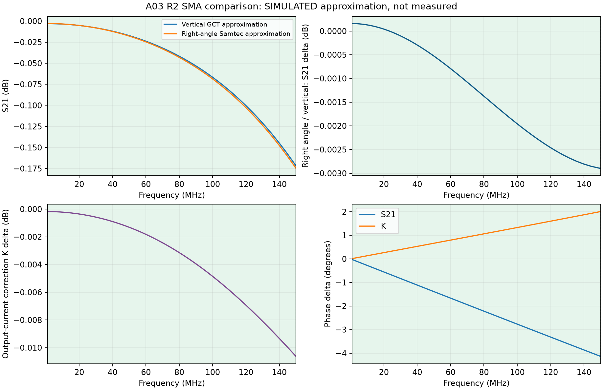

# 직각 SMA 포트 수정 및 정상 재계산, 2026-10-27

**계산 모델의 포트 오류를 수정하고1–150MHz 수치 검증을 통과했다.** 실물 RF 성능 인증과는 구별한다. Fixture A03 SMA R2에 보유 Samtec SMA-J-P-H-RA-TH1 두 개를 사용한다는DEC-081의 부품 선택을 유지하며, 완성한 그 지그로 교정한다.

## 비교 결과

직각 모델 ÷ 수직 모델의 변화다. S21은 빈 지그 전달, K는코어 위치 전류/출력 전류의 비율이다. ΔK를 실제 잔여 오차로 부르지 않는다. 정확한 제조사 내부EM 모델 대신 도면 기반 근사 형상을 사용했다.

| MHz | ΔS21 dB | ΔS21 위상° | ΔK dB | ΔK 위상° |
|---|---:|---:|---:|---:|
| 100 | -0.002 | -2.77 | -0.005 | +1.33 |
| 150 | -0.003 | -4.14 | -0.011 | +2.01 |

[주파수별 계산](comparison.csv) · [원시 환산·밴드 최대값](comparison.json) · [검증 결과](VALIDATION.json)

## 오류와 수정

이전RA 출력 전류 프로브는 격자에 맞춰진 뒤x 시작/끝이 같아져 적분 면적이0이었다. 그 실행의 원시 파일과 무효 판정은 [이전 실패 기록](../sma_right_angle_20261026/REJECTED_FULL_WAVE.json)에 그대로 남겼다.

포트를 앞끝에서0.8mm 안쪽으로 옮기고, 두 접선 방향에 최소3개 셀 간격을 확보했다. 필수 격자면과 포트 경계를 실제 격자 좌표에 맞췄다. 짧은 실제 실행에서 전류 프로브 헤더와PEC 신호/접지 연결·절연을 먼저 확인한 뒤 본 계산을 했다. 두 커넥터 모델은 **동일한 전체 격자**를 사용했다. 제어 동축으로 확인한 Ampere 전류 방향도 메타데이터와 독립 환산에서 일치시켰다.

## 실제 검증

| 모델 | 최종 기록ns | 출력 −U/I와50Ω의 최대 복소차, ≤150MHz | 두 전류루프 최대차, ≤150MHz |
|---|---:|---:|---:|
| 수직 | 6.444 | 0.168% | 0.0133% |
| 직각 | 6.485 | 0.185% | 0.0134% |

- openEMS 후처리를 원시ASCII 독립DFT와 대조했다. 모든 실행의 실제 전류 프로브 면적과 최종PEC 연결·절연을 확인했다.
- 마지막0.5/1.0ns를 제거한 두 시간창에서S21·K 변화≤0.01dB/0.1°, S11 복소차≤0.002, 출력50Ω 복소차≤1%, 반사+전달 전력비≤1.01을 확인했다. 이 값은 제품 합격기준이 아니라 이번 계산의 수치 안정성 예산이다. 최초 안정 이후 추가0.5ns 이상 확인한 실행은 공식ABORT 파일로 후처리까지 보존하며 종료했다. 자동 종료 여부·실제 시간은 각 로그에 있다.
- 종료 판정은1–150MHz 포트/전류 응답의 시간창 안정성이다. 전역 잔류에너지1e-6(−60dB) 종료조건이나3GHz 전체대역 수렴을 달성했다고 보고하지 않는다. 높은 주파수 잔류장은 별개다.
- 여기 펄스 대역1GHz/3GHz를 바꾼 제어 동축에서도1–150MHz의S21·K 변화가0.01dB/0.1° 이내였다. 추가로 동축 포트 격자를 더 세밀하게 비교했다. 이는 **전체PCB 메쉬 수렴검사와 다르다**. 수치와 절대위상/이상선로 차이는VALIDATION.json에 모두 남겼다.
- 이전 실패 재현·수정 프로브·동일 격자·핀 기준면·실제 구멍·원본 해시·단위/위상/캐스케이드 관련6개 회귀시험을 수행했다. 제조 원본43개는 해시가 동일하다. 새ERC/DRC·실측을 실행했다고 보고하지 않는다.

현행 보존검사는1575파일·ZIP구성96개·진입링크278개를 검사했다. 과거 해시와 달라 실패로 남은 항목은 이전 클램프 관측의STATUS/CURRENT_READINESS와 결정 추가의DECISIONS, 세 문서다. 의도한 변경 전후 원장을 보존했으며 과거 잠금은 고치지 않았다. [보존검사 원문](release_preservation_check.json) · [별도 무결성 확인](review_integrity.json)

## 적용 범위와 다음 실물 확인

openEMS0.37.0rc2/CSXCAD0.7.0rc2, 저장된 현재R2 filled copper를 사용했다. 내부 보어2.13mm, PTFE εr2.1, FR4 εr4.3, 몸체 간극0.1mm, 직각 내부L형 경로·PEC/무손실·이상적 솔더 충전은 근사 가정이다. 코어·권선·헤드·케이블·실제 솔더 필렛은 포함하지 않는다. 실제 부품S2P/물리손실·실물 편차의 보증값이 아니다. 기준 동축의 절대 위상에도 포트 근사 영향이 남아 있으므로 작은 위상 차이의 자릿수를 정확도 보증으로 읽지 않는다.

판단은 사용자 요청의1–150MHz다. 높은 주파수 환산 자료는 보존하지만 이 판정 범위로 확장하지 않는다. 완성된 직각 실장 지그로 [기존G2 절차](../../docs/G2_BENCH_PROCEDURE.md)에 따라 `fixture_through_empty.s2p`, `fixture_through_head_loaded.s2p`, `probe_transfer_5t_Lm30.s2p`, `primary_load_s11.s1p`와 역방향을 저장한다. ΓL·K 적용범위·직접 픽업·null·반복성을 확인한 구간만 절대ZT로 표시한다.

[제조사 도면·부품 사양](../sma_right_angle_20261026/specifications.json) · [실행 원본](runs/) · [수정 이력](WORK_LOG.md) · [문서 전후 원장](document_changes.json)

공개 조립 절차서와 제조 원본은 변경하지 않았다. 기존 클램프 사용보류와 헤드 권선3MΩ 접속 점검은 별도이며, 이 계산으로 실물 접속이나 기계적 결함이 해결된 것은 아니다.
